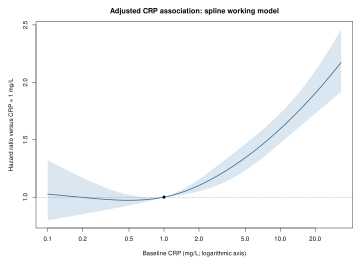

## Propósito y forma de lectura {#sec-lectura}

Este es un manuscrito alternativo de aprendizaje, más extenso que el borrador científico. Su objetivo es permitir que el investigador reconstruya la lógica del estudio, cuestione sus supuestos y pueda explicar sus decisiones sin depender de recordar comandos de R. No sustituye al protocolo, al plan estadístico congelado ni a sus enmiendas. Tampoco modifica resultados ni añade modelos.

La explicación se organiza desde la pregunta científica hacia las decisiones de diseño, el modelo de supervivencia, las extensiones y los datos faltantes. Las fórmulas describen primero la idea general y después su aplicación concreta. Cuando una expresión es simplificada —por ejemplo, una verosimilitud sin pesos ni empates— se indica expresamente: no debe confundirse esa expresión docente con todos los detalles del software utilizado.

Hay cuatro niveles de certeza que conviene mantener separados:

| Nivel | Qué significa | Qué no significa |
| --- | --- | --- |
| Regla preespecificada | Se documentó antes de mirar asociaciones | Que sea la única elección defendible |
| Implementación verificada | El código respeta reglas y produce objetos coherentes | Que el modelo describa perfectamente la realidad |
| Diagnóstico favorable | No apareció determinado patrón preocupante en los controles realizados | Que se hayan demostrado todos los supuestos |
| Resultado sustantivo | Una estimación obtenida bajo un conjunto explícito de decisiones | Una relación causal o una verdad independiente del modelo |

Las cifras corresponden a las salidas guardadas, incluidas las correcciones documentadas. Los ejemplos con personas ficticias o probabilidades hipotéticas se presentan únicamente para explicar conceptos. La versión fuente puede leerse en Markdown; la versión HTML incorpora índice navegable y ecuaciones para estudiar por secciones.

**Pregunta que debería poder contestar al terminar:** ¿qué parte del resultado depende de los datos, cuál del diseño de encuesta, cuál de la forma funcional del modelo y cuál de los supuestos sobre los valores ausentes?

## Pregunta científica: asociación pronóstica, causalidad y predicción {#sec-pregunta}

La pregunta del estudio es si una concentración basal más alta de proteína C reactiva, que llamaremos CRP para conservar el nombre usado en el código, está asociada con mayor mortalidad posterior entre adultos representados por NHANES 1999–2010.

La palabra **basal** importa. Se dispone de una medición al inicio, no de una historia longitudinal completa de CRP. El modelo relaciona ese marcador inicial con la evolución posterior. No describe cómo cambia el hazard de una misma persona cuando su CRP sube o baja con el tiempo.

La palabra **asociada** también importa. No se asignó aleatoriamente una intervención que modificara CRP. Una concentración alta puede reflejar múltiples procesos medidos y no medidos. Ajustar por covariables no convierte automáticamente el coeficiente en el efecto de intervenir sobre CRP. La asociación ajustada tampoco identifica por sí sola si CRP es causa, marcador, consecuencia de enfermedad previa o una combinación de estos mecanismos.

Además, un estudio de asociación pronóstica no equivale a un estudio de **predicción clínica validada**. Para este último harían falta, entre otras cosas, objetivos de predicción bien definidos, estimación de riesgos absolutos y evaluación de calibración/discriminación en datos adecuados. Aquí no hemos demostrado que añadir CRP a una herramienta clínica mejore decisiones.

Por tanto, la cantidad primaria buscada es una razón de hazards ajustada por duplicación de CRP. Si la relación es no lineal o cambia con el seguimiento, ese número funciona como un resumen del modelo de trabajo; no como una constante biológica universal.

## Qué aportó congelar el protocolo {#sec-congelacion}

El protocolo y el SAP v0.3 se congelaron antes del análisis de asociaciones. Esto separa decisiones científicas iniciales de decisiones potencialmente influidas por resultados atractivos. Se fijaron la exposición, el desenlace, las covariables, la población, la escala temporal, las sensibilidades y las dos hipótesis de modificación del efecto.

Congelar no vuelve intocable una implementación que falla ni elimina problemas que sólo se detectan al abrir los desenlaces. Obliga a registrar el cambio y su momento. La historia real del proyecto es:

| Decisión | Momento y condición |
| --- | --- |
| Especificación principal y sensibilidades generales | SAP v0.3 congelado antes de asociaciones |
| Asignar 0,5 meses a cuatro fallecimientos del mes del examen | Enmienda 001: tras abrir seguimiento, antes del primer ajuste de asociación |
| Sustituir interacción continua con log-tiempo por cuatro períodos | Enmienda 002: tras diagnósticos auxiliares y fallo computacional, antes de estimar el modelo sustituto |
| Probar edad lineal como sensibilidad | Enmienda 003: después de conocer resultados principales, antes de ejecutar esa sensibilidad |
| Detalles finales de imputación y paralelización | Desarrollados tras el análisis principal; documentados y probados antes de la imputación real |
| Interacciones por sexo y grupo de edad | Hipótesis preespecificadas; detalles de implementación registrados el 23 de octubre antes de sus ajustes |

Esta cronología impide presentar retrospectivamente todas las decisiones como si hubieran sido anteriores a cualquier resultado. La reproducibilidad incluye honestidad temporal, no sólo disponer de código.

## Población, elegibilidad y construcción de la cohorte {#sec-cohorte}

### Población objetivo y población analizada

NHANES usa un diseño probabilístico complejo para representar a la población civil no institucionalizada de Estados Unidos. Nuestro análisis agrupa seis ciclos, desde 1999–2000 hasta 2009–2010. La población efectivamente analizada exige además ser adulto, disponer de CRP positiva, tener peso MEC positivo, ser elegible para enlace de mortalidad y cumplir las otras reglas.

Estas restricciones importan para la generalización. Los pesos originales no garantizan que cualquier subconjunto seleccionado por medición disponible, enlace y covariables completas sea automáticamente representativo sin supuestos adicionales. La imputación amplía la cohorte analizada para covariables faltantes, pero no recupera a quienes carecían de exposición o eran inelegibles para enlace.

### Flujo observado

| Etapa | Participantes |
| --- | ---: |
| Adultos con CRP positiva y peso MEC positivo | 28.924 |
| Elegibles para enlace de mortalidad | 28.890 |
| Embarazos confirmados excluidos | 1.135 |
| Cohorte elegible final | 27.755 |
| Casos completos para ajuste principal | 26.818 |
| Con al menos una covariable primaria faltante | 937 |
| Casos completos añadiendo ingreso/pobreza | 24.683 |

Los 937 participantes con faltantes son personas, no celdas: una persona puede tener varios valores ausentes. Los fallecimientos fueron 5.886 en casos completos y 6.354 en la cohorte elegible. Son conteos observados, no totales poblacionales estimados mediante pesos.

### Embarazo e indeterminación

El embarazo confirmado se excluyó por la comparabilidad de las mediciones y la interpretación de CRP y BMI en la pregunta planteada. Es una restricción del ámbito del estudio, no una afirmación de que el embarazo sea un dato erróneo.

La indeterminación no se convirtió en embarazo confirmado ni en ausencia confirmada. Se retuvo en el principal y se evaluó mediante sensibilidad. Había 209 participantes elegibles con esa clasificación; 180 pertenecían a casos completos. De ahí que excluirlos del análisis principal reduzca 26.818 a 26.638, no en 209 personas.

### Identificadores, códigos especiales y saltos de cuestionario

Los componentes se unen con `SEQN`, comprobando unicidad para evitar que una unión multiplique registros. Duplicar accidentalmente una persona alteraría pesos, riesgo y número de eventos; no sería un detalle de formato.

Un código numérico para «no sabe» o «rechaza contestar» no es una categoría clínica válida. Se recodificó a faltante antes de decidir casos completos. Por eso los conteos finales difieren de una auditoría inicial que sólo contaba `NA` convencionales.

Tampoco toda pregunta no realizada significa información faltante. Si alguien nunca fumó y una pregunta posterior sólo se formula a quienes fumaron, ese salto estructural no impide clasificarlo como nunca fumador. El código de derivación distingue estos casos.

## Variables de ajuste: qué significan y por qué no se seleccionaron por p {#sec-ajuste}

El modelo demográfico incluye edad, sexo, raza/origen hispano y ciclo. El principal añade educación, tabaquismo, BMI, diabetes, hipertensión y enfermedad cardiovascular prevalente. No se seleccionaron variables mediante pruebas univariables, procedimientos escalonados o la búsqueda de la menor p.

La justificación es sostener una pregunta ajustada definida con anterioridad, en lugar de dejar que el ruido muestral decida qué significa «ajustado». Esto no demuestra que el conjunto contenga todos los determinantes relevantes ni que cada variable tenga interpretación causal identificada. En un estudio pronóstico, ajustar por enfermedad prevalente puede cambiar deliberadamente la asociación residual que queremos describir, sin identificar efectos directos causales.

| Constructo | Implementación y cautela |
| --- | --- |
| Edad | Años basales con spline; no se supone linealidad global |
| Sexo | Categorías de `RIAGENDR`; no se reinterpretan como una medición exhaustiva de género |
| Raza/origen hispano | Cinco categorías armonizadas; no se atribuye causalidad biológica a sus coeficientes |
| Educación | Cinco categorías, sin imponer distancias numéricas iguales |
| Tabaquismo | Nunca, exfumador, actual, respetando rutas del cuestionario |
| BMI | Medición positiva, continua; no se categoriza por conveniencia inferencial |
| Diabetes | No, borderline, sí; borderline no se fusiona después de ver resultados |
| Hipertensión | Respuesta al antecedente diagnóstico; no equivale a una clasificación exhaustiva basada en presión medida |
| CVD prevalente | Sí si algún componente es afirmativo; no sólo si todos son explícitamente negativos; en otro caso, faltante |
| Ciclo | Factor para diferencias entre períodos de reclutamiento |
| Ingreso/pobreza | Ajuste adicional de sensibilidad, no covariable primaria |

El mayor faltante de ingreso/pobreza —2.244 registros, 8,09% de elegibles— motivó su ubicación separada, junto con la disponibilidad de educación como dimensión socioeconómica más completa. No son constructos intercambiables: incluir educación no prueba que el ajuste socioeconómico sea suficiente.

Comparar el modelo demográfico con el principal no es una descomposición causal del cambio del coeficiente. En modelos de hazards, la no colapsabilidad y los cambios del conjunto condicionado también influyen; no puede interpretarse mecánicamente toda atenuación como «porcentaje explicado».

## CRP: unidades, logaritmo y límite de detección {#sec-exposicion}

### Convertir unidades antes de interpretar

La variable liberada está expresada en mg/dL. Multiplicamos por diez:

$$
\mathrm{CRP}_{mg/L}=10\,\mathrm{CRP}_{mg/dL}.
$$

La conversión evita presentar umbrales y contrastes en una unidad distinta de la prevista. Si se cambiara únicamente la unidad dentro de un logaritmo, se añadiría una constante al predictor; en este modelo la pendiente por duplicación no cambiaría por esa constante. Pero sí serían erróneas las etiquetas de 1, 2, 4 u 8 mg/L si no se hiciera la conversión correctamente.

### Por qué logaritmo base dos

Definimos $X=\log_2(\mathrm{CRP})$. Entonces:

$$
\log_2(2c)-\log_2(c)=1.
$$

El mismo incremento del predictor compara 1 con 2 mg/L, 2 con 4 o 4 con 8. Bajo el modelo lineal en log2, todas esas duplicaciones tienen el mismo HR, $e^\beta$. Esa igualdad es una restricción del modelo, que después examinamos con un spline.

No es necesario que CRP tenga una distribución normal para usar un predictor logarítmico en Cox. La elección afecta la forma de su relación con el log-hazard, la interpretación y la influencia de la cola, no convierte a Cox en una regresión normal de CRP.

Para multiplicar CRP por un factor $a$:

$$
HR(c\to ac)=\exp\{\beta\log_2(a)\}.
$$

Así, cuadruplicar equivale a dos duplicaciones y el HR sería $e^{2\beta}$. Una diferencia absoluta de 1 mg/L no tiene un HR constante en esta escala: pasar de 1 a 2 no es la misma razón de concentraciones que pasar de 10 a 11.

### Datos bajo el límite de detección

El archivo público contiene un valor liberado de 0,01 mg/dL para observaciones identificadas como bajo detección. El límite nominal documentado es 0,02 mg/dL. Conservamos el valor público en el principal; sustituimos por 0,02 mg/dL y excluimos esas observaciones en sensibilidades separadas.

La documentación describe una regla basada en límite dividido por $\sqrt 2$, pero $0,02/\sqrt 2\simeq0,01414$ no es numéricamente igual a 0,01. No reconstruimos una precisión que no está en el valor liberado ni tratamos ese valor como concentración exacta. El manuscrito debe distinguir la regla documentada del número efectivamente disponible. El indicador usado se basa en el valor público y en la auditoría de archivos.

**Conclusión de esta decisión:** mantenemos una regla primaria reproducible y evaluamos dependencia de esa regla; no recuperamos la concentración verdadera por debajo del límite.

## Seguimiento, censura y cuatro tiempos iguales a cero {#sec-tiempo}

Para cada persona definimos un tiempo observado y un indicador:

$$
T_i=\min(T_i^{\mathrm{muerte}},C_i),
\qquad
\delta_i=I(T_i^{\mathrm{muerte}}\le C_i),
$$

donde $C_i$ representa el final de observación disponible. La escala es tiempo transcurrido desde el examen MEC, en meses, con mortalidad pública enlazada hasta el cierre de 2019. Esto no es edad alcanzada como escala temporal: la edad basal entra como covariable.

Una persona censurada aporta que sobrevivió hasta su tiempo observado y contribuye a los conjuntos de riesgo previos. No se trata como alguien que jamás morirá ni como una muerte en la fecha de cierre.

La inferencia necesita supuestos sobre el mecanismo de observación/censura y la calidad del enlace. El hecho de que exista una fecha administrativa de cierre no demuestra por sí solo independencia de toda ausencia de seguimiento o de toda clasificación del desenlace. La elegibilidad de enlace y las limitaciones del archivo público deben describirse.

Cuatro personas tienen muerte registrada y seguimiento liberado de cero meses. Interpretamos esa resolución mensual como muerte en el mismo intervalo del examen y asignamos 0,5 meses al análisis, conservando el valor original. Es una aproximación de punto medio, no una fecha reconstruida.

El pipeline exige tiempos analíticos positivos. No debe extrapolarse de esa regla que todo software Cox sea matemáticamente incapaz de aceptar un evento codificado en cero: la aceptación técnica de un número no resuelve su interpretación como tiempo agrupado. La Enmienda 001 eligió una convención explícita para este proyecto.

**Pendiente específico identificado al redactar:** esa enmienda promete una sensibilidad excluyendo los cuatro eventos. No aparece una salida específica de ella en los scripts/tablas de sensibilidades revisados. Las exclusiones de muertes de 12/24 meses incluyen esos eventos, pero no aíslan el efecto de quitar sólo cuatro. No podemos describir esa sensibilidad específica como ejecutada hasta reconciliarla. Este documento no la ejecuta ni inventa su resultado.

## Por qué supervivencia y qué significa hazard {#sec-hazard}

El hazard es una tasa instantánea condicionada a seguir vivo justo antes de $t$:

$$
h(t\mid\mathbf x)
=\lim_{\Delta t\to0}
\frac{\Pr(t\le T<t+\Delta t\mid T\ge t,\mathbf x)}{\Delta t}.
$$

La función de supervivencia es $S(t\mid\mathbf x)=\Pr(T>t\mid\mathbf x)$. Ambas se relacionan mediante:

$$
S(t\mid\mathbf x)=\exp\{-H(t\mid\mathbf x)\},
\qquad
H(t\mid\mathbf x)=\int_0^t h(u\mid\mathbf x)\,du.
$$

Una regresión logística del estado final perdería parte de la información temporal y compararía personas con ventanas de seguimiento diferentes sin modelarlas de la misma manera. Cox permite usar el orden de los eventos y el tiempo que cada participante permanece en riesgo, conservando la censura bajo sus supuestos.

Un HR de 1,13 no significa que muera un 13% adicional de todas las personas ni que la probabilidad de morir a diez años aumente 13 puntos porcentuales. Es una razón entre hazards del modelo, condicionada a las covariables y al conjunto de supervivientes en cada instante.

Incluso bajo PH, si $S_0(t)$ fuera la supervivencia de referencia y $\eta$ un predictor lineal, tendríamos:

$$
S(t\mid\mathbf x)=S_0(t)^{\exp(\eta)}.
$$

Para convertir un contraste de hazards en un contraste de riesgo absoluto se necesita además el hazard o la supervivencia basal y una población de comparación definida. Este estudio no valida una calculadora individual de riesgo.

## El modelo de Cox y cómo se estima {#sec-cox}

### Estructura del modelo principal

$$
h_i(t)=h_0(t)\exp\left\{
\beta X_i+f(\mathrm{edad}_i)+\boldsymbol\gamma^\top\mathbf Z_i
\right\},
\qquad X_i=\log_2(\mathrm{CRP}_i).
$$

$h_0(t)$ queda sin una forma paramétrica prefijada. La parte exponencial describe razones de hazards. «Semiparamétrico» no significa «sin supuestos»: se especifican el predictor, las formas funcionales y la constancia temporal de los coeficientes del modelo principal.

### Verosimilitud parcial: intuición sin pesos ni empates

Si la persona $i$ fallece en $t_i$, y $R(t_i)$ es el conjunto en riesgo inmediatamente antes, su contribución es:

$$
\frac{\exp(\boldsymbol\theta^\top\mathbf x_i)}
{\sum_{j\in R(t_i)}\exp(\boldsymbol\theta^\top\mathbf x_j)}.
$$

El producto de esas contribuciones compara quién fallece en cada evento con quienes podían fallecer en ese momento. El hazard basal común se cancela. El algoritmo no estima $\beta$ simplemente dividiendo la CRP media de fallecidos por la de supervivientes.

La ecuación de score correspondiente es:

$$
U(\boldsymbol\theta)=
\sum_{i:\delta_i=1}
\{\mathbf x_i-\overline{\mathbf x}_{R(t_i)}(\boldsymbol\theta)\}=0,
$$

con promedio de riesgo ponderado por $e^{\boldsymbol\theta^\top\mathbf x_j}$. Esta ecuación introduce la idea; la ejecución real incorpora pesos y empates.

### Ponderación de encuesta

Una expresión conceptual, sin empates, del score ponderado es:

$$
U_w(\boldsymbol\theta)=
\sum_iw_i\delta_i
\left[
\mathbf x_i-
\frac{\sum_{j\in R(t_i)}w_j\mathbf x_j e^{\boldsymbol\theta^\top\mathbf x_j}}
{\sum_{j\in R(t_i)}w_j e^{\boldsymbol\theta^\top\mathbf x_j}}
\right].
$$

Los pesos afectan tanto la contribución del evento como la composición ponderada del riesgo. No basta con ajustar un Cox convencional y multiplicar su HR por un peso promedio.

### Empates y aproximación de Efron

El seguimiento en meses genera muertes con el mismo tiempo observado. En una ilustración no ponderada, para $d$ muertes empatadas, Efron aproxima el denominador con factores:

$$
\prod_{\ell=0}^{d-1}
\left[
\sum_{j\in R(t)}e^{\eta_j}
-\frac{\ell}{d}\sum_{j\in D(t)}e^{\eta_j}
\right],
$$

donde $D(t)$ contiene las muertes empatadas. Así representa una retirada gradual del conjunto que fallece. Esta fórmula docente no sustituye la implementación de Efron con pesos no enteros. La elección concreta está fijada en el SAP y corresponde al argumento `method="efron"` [S2](https://www.stat.ethz.ch/R-manual/R-devel/library/survival/html/coxph.html).

No elegimos el método exacto después de comparar p-valores. Tampoco afirmamos que Efron reconstruya el orden de muerte dentro de cada mes.

## Diseño de encuesta: pesos, estratos, PSUs y varianza {#sec-encuesta}

### Tres funciones distintas

El peso representa la contribución del participante a la población objetivo bajo la construcción de la encuesta. El estrato organiza el muestreo; la PSU identifica una unidad de selección agrupada. Dos personas de la misma PSU no aportan necesariamente información independiente como en un muestreo aleatorio simple.

La indicación `nest=TRUE` interpreta correctamente las etiquetas de PSU dentro de estratos. Un código `SDMVPSU=1` no identifica una única unidad común a todo el estudio. Asimismo, `strata=~SDMVSTRA` del **diseño de encuesta** no equivale a añadir `strata(SDMVSTRA)` a la fórmula de Cox: lo segundo permitiría hazards basales distintos por estrato y sería otro modelo.

### Por qué no dividir todos los pesos bienales por seis

La regla aplicada es:

$$
w_i^{pool}=\begin{cases}
\mathrm{WTMEC4YR}_i/3,&1999\text{–}2002,\\
\mathrm{WTMEC2YR}_i/6,&2003\text{–}2010.
\end{cases}
$$

El primer bloque representa cuatro de doce años y los otros, dos de doce. La guía NCHS exige iniciar con el peso cuatrienal al combinar 1999–2000 con 2001–2002 [S1](https://wwwn.cdc.gov/nchs/nhanes/tutorials/weighting.aspx). La diferencia no es una constante común que podamos ignorar: modifica la contribución relativa de los primeros ciclos.

El filtro inicial del código utiliza positividad de `WTMEC2YR`; el peso analítico final sí se construye con la regla anterior. Una comprobación de lectura de los archivos fuente, realizada para este manuscrito, encontró cero discrepancias de pertenencia entre positividad bienal y cuatrienal entre adultos con CRP positiva en esos dos ciclos: 4.145 y 4.729, respectivamente. Esto verifica equivalencia de ese filtro **en estos archivos**, no equivalencia de los valores de los pesos.

### Estructura sandwich

La covarianza de diseño tiene la forma general:

$$
\widehat{\operatorname{Var}}(\widehat{\boldsymbol\theta})
=A^{-1}B_{design}A^{-\top}.
$$

$A$ representa la sensibilidad de las ecuaciones y $B_{design}$ estima la variabilidad de las contribuciones teniendo en cuenta el agrupamiento y la estratificación. Una expresión ilustrativa de esta segunda parte es:

$$
B_{design}=\sum_h\frac{n_h}{n_h-1}
\sum_{a=1}^{n_h}(\mathbf g_{ha}-\bar{\mathbf g}_h)
(\mathbf g_{ha}-\bar{\mathbf g}_h)^\top,
$$

con contribuciones linealizadas por PSU. La implementación exacta corresponde a `survey`; no se calculó a mano a partir de esta fórmula simplificada. El modelo no se valida comparando sólo el tamaño del SE con el de un Cox sin encuesta.

### Qué significan 91 grados de libertad

En la cohorte validada hay 180 PSUs anidadas y 89 estratos:

$$
\nu_{design}=180-89=91.
$$

No son 91 participantes ni 91 eventos. Tampoco significa que **todos** los tests del proyecto usen denominador 91. Los tests Wald de spline e interacciones usan los df residuales que devuelve su modelo; el test temporal con réplicas usa 91, y Rubin aplica su convención finita. Hay que informar qué referencia usa cada cálculo.

### Qué representa la población tras seleccionar casos completos

Mantener pesos originales no corrige automáticamente toda selección adicional por tener covariables completas. El análisis principal se refiere a la cohorte completa observada bajo supuestos de transportabilidad/modelo. La MI es una comprobación frente a esta pérdida específica; no resuelve selección previa por CRP, enlace o embarazo, ni prueba representatividad universal.

## Edad y CRP con splines: flexibilidad controlada {#sec-splines}

### Por qué evitar una recta rígida para edad

Si la relación real de edad con el log-hazard es curva, una edad lineal puede dejar estructura residual asociada a CRP. Un spline permite curvatura sin convertir cada año en un parámetro independiente ni elegir categorías al mirar el resultado.

Los puntos de edad congelados fueron **22, 38, 52 y 78 años**, correspondientes a percentiles ponderados 5, 35, 65 y 95. El código usa `splines::ns`, con 38 y 52 como nudos interiores y 22/78 como límites. Produce tres columnas. La base natural cúbica abarca el mismo espacio funcional de spline cúbico restringido con esos nudos, aunque sus coeficientes no sean numéricamente intercambiables con otra parametrización.

«Colas lineales» significa linealidad del predictor spline fuera de los límites, no linealidad del hazard sin transformar ni ausencia de observaciones fuera de 22–78. Las edades fuera de ese intervalo no se descartaron.

### Base de CRP y restricciones

Para CRP, la base contiene el término lineal $x=\log_2(CRP)$ y dos funciones no lineales. Con nudos $\kappa_1<\dots<\kappa_K$, una parametrización usa:

$$
d_j(x)=\frac{
(x-\kappa_j)_+^3
-\frac{\kappa_K-\kappa_j}{\kappa_K-\kappa_{K-1}}(x-\kappa_{K-1})_+^3
+\frac{\kappa_{K-1}-\kappa_j}{\kappa_K-\kappa_{K-1}}(x-\kappa_K)_+^3
}{(\kappa_K-\kappa_1)^2},\quad j=1,\ldots,K-2.
$$

Aquí $(u)_+=\max(u,0)$ y $K=4$. La función es:

$$
g(x)=\alpha_1x+\alpha_2d_1(x)+\alpha_3d_2(x).
$$

La restricción de colas reduce flexibilidad extrema donde suele haber poca información. Los nudos congelados en escala log2 fueron aproximadamente $-2,32193$, $0,13750$, $1,58496$ y $3,87774$, equivalentes a **0,2; 1,1; 3,0 y 14,7 mg/L**. No se optimizaron para obtener una curva más significativa.

### Test global, no linealidad y contrastes

El test global evalúa $\alpha_1=\alpha_2=\alpha_3=0$. El de no linealidad evalúa sólo $\alpha_2=\alpha_3=0$. Son preguntas distintas. La p de no linealidad fue aproximadamente 0,000311, con F(2,65) = 9,169.

Para comparar $c$ mg/L con 1 mg/L, formamos la diferencia entre sus bases:

$$
\mathbf L(c)=\mathbf b(\log_2 c)-\mathbf b(\log_2 1),
$$

$$
\log HR(c:1)=\mathbf L(c)^\top\widehat{\boldsymbol\alpha},
\quad
\operatorname{Var}\{\log HR(c:1)\}
=\mathbf L(c)^\top\widehat V_\alpha\mathbf L(c).
$$

La covarianza entre términos es indispensable. No se obtiene el intervalo sumando los errores estándar de las columnas.

Los contrastes observados fueron 1,102 para 2 frente a 1 mg/L; 1,275 para 4 frente a 1; y 1,507 para 8 frente a 1. Sus intervalos están en las tablas del borrador científico. La figura muestra percentiles ponderados 1–99 para evitar que una región casi vacía domine la escala visual; esa restricción de dibujo no excluye datos del ajuste.

## Proporcionalidad y variación a lo largo del seguimiento {#sec-ph}

### Qué se supone constante

El modelo principal impone que $\beta$ no dependa de $t$. Esto no significa un hazard constante: $h_0(t)$ puede cambiar libremente. Significa que, dentro del modelo y manteniendo covariables, la razón $h(t\mid X+1)/h(t\mid X)$ es $e^\beta$ para todos los tiempos.

No linealidad y no proporcionalidad son problemas diferentes. Un spline permite que la asociación cambie según el valor de CRP, pero no según el tiempo si sus coeficientes son constantes. Una interacción temporal permite coeficientes distintos en el seguimiento, pero puede seguir imponiendo linealidad en log2 dentro de cada período.

### Schoenfeld como diagnóstico auxiliar

Un residual de Schoenfeld compara la covariable del evento con su promedio esperado en el riesgo. Una tendencia temporal de residuales escalados sugiere que el coeficiente constante está dejando estructura sin representar.

Se aplicó `cox.zph` a un modelo auxiliar ponderado y agrupado por PSU. Ese modelo no reproduce por completo la varianza estratificada de `svycoxph`. Su test para CRP dio p aproximadamente $4,63\times10^{-6}$, pero no se utilizó como único fundamento de inferencia poblacional. La prueba de diseño se hizo por separado.

### Por qué cambiamos el modelo temporal previsto

El plan inicial era una interacción de CRP con $\log(t)$. La implementación `tt()` expandía datos por conjuntos de riesgo y agotó memoria. No se obtuvo un resultado válido de ese modelo. La Enmienda 002 definió entonces cuatro períodos antes de ver sus estimaciones.

La alternativa tiene coeficiente por período:

$$
h_i(t)=h_0(t)\exp\left\{
\sum_{r=1}^4\beta_rX_iI(t\in I_r)
+f(edad_i)+\boldsymbol\gamma^\top\mathbf Z_i
\right\}.
$$

Los cortes son 60, 120 y 180 meses. Una persona que vive más de quince años puede aportar cuatro filas start–stop; cada fila describe cuándo está en riesgo. Sigue siendo una persona, con como máximo una muerte. La expansión produjo 81.509 filas y conservó los 5.886 eventos.

Esta representación no convierte automáticamente todos los demás coeficientes en temporales ni establece PH para el resto del ajuste. Es una aproximación parcial, explícita y computacionalmente viable.

### Réplicas JKn y contraste global

Se construyeron 180 réplicas de diseño, eliminando una PSU por réplica y ajustando pesos según el esquema JKn. La covarianza tiene la estructura:

$$
\widehat V_{JKn}
=s\sum_{r=1}^{180}a_r
(\widehat{\boldsymbol\theta}^{(r)}-\widehat{\boldsymbol\theta})
(\widehat{\boldsymbol\theta}^{(r)}-\widehat{\boldsymbol\theta})^\top,
$$

con escala $s$ y factores $a_r$ suministrados por `survey`; se utilizó centrado MSE en el estimador de muestra completa. No se promediaron ingenuamente HRs de réplicas como si fueran imputaciones. Las réplicas estiman incertidumbre de muestreo; las imputaciones representan incertidumbre por datos ausentes: son operaciones diferentes.

La hipótesis temporal es:

$$
H_0:\beta_1=\beta_2=\beta_3=\beta_4.
$$

Con una matriz de tres contrastes $C$, se calcula:

$$
F=\frac{(C\widehat{\boldsymbol\beta})^\top
(C\widehat V C^\top)^{-1}
(C\widehat{\boldsymbol\beta})}{3},
$$

usando referencia F(3,91). El resultado fue F = 2,824 y p = 0,0431. Los HRs por duplicación fueron 1,180; 1,109; 1,096 y 1,156 en los cuatro períodos. Las muertes correspondientes fueron 1.675; 2.146; 1.468 y 597.

No hay una caída monótona hasta el final: el último estimador vuelve a aumentar y es menos preciso. Los cortes no identifican transiciones biológicas exactas. Con estos resultados no debemos presentar 1,130 como efecto idéntico en todo momento.

## Qué podemos leer del resultado principal {#sec-principal}

El coeficiente principal fue $\widehat\beta=0,1220883$, con SE de diseño $0,0096146$. Por tanto:

$$
HR=e^{0,1220883}=1,129854.
$$

El intervalo usa la convención normal del análisis principal:

$$
IC_{95\%}=\exp\{\widehat\beta\pm1,959964\,SE\}
=[1,108762;\ 1,151347].
$$

Se puede describir como aproximadamente 13% mayor hazard por duplicación de CRP **dentro del resumen ajustado del modelo**. No son 13 puntos porcentuales de riesgo, ni el efecto causal de bajar CRP, ni una constante válida en toda la curva y el seguimiento.

La p principal, aproximadamente $6,05\times10^{-37}$, corresponde a una hipótesis específica sobre el coeficiente del modelo. No mide importancia clínica, probabilidad de causalidad ni probabilidad de que todos los supuestos sean correctos. Una p pequeña no corrige mala codificación, sesgo de selección o error en la forma funcional.

Dado que detectamos no linealidad y variación temporal, comunicar sólo este número sería incompleto. La solución no fue buscar otro modelo con una p preferida, sino acompañar el resumen principal con los análisis predefinidos y sus límites.

## Datos faltantes: qué problema intentamos resolver {#sec-faltantes}

La cohorte elegible tiene 937 personas con al menos una covariable primaria ausente. El conteo por variable es:

| Variable | Valores ausentes | Porcentaje de 27.755 |
| --- | ---: | ---: |
| BMI | 575 | 2,072% |
| Educación | 48 | 0,173% |
| Tabaquismo | 31 | 0,112% |
| Diabetes | 19 | 0,068% |
| Hipertensión | 164 | 0,591% |
| CVD prevalente | 147 | 0,530% |

La suma es 984 celdas, mayor que 937 personas. No se puede sumar porcentajes por variable para obtener directamente el porcentaje de personas incompletas.

### Por qué casos completos como principal

Era la regla congelada, conserva un análisis transparente sin modelar valores ausentes y retiene 96,62% de elegibles. Su alta retención no demuestra ausencia de sesgo. Quienes quedaron incompletos no constituyen necesariamente una pequeña muestra aleatoria del resto: por ejemplo, el grupo con BMI faltante tenía mayor edad y mayor proporción de muertes observadas.

Casos completos puede ser válido bajo determinadas estructuras de selección y modelos, incluso algunas que no son MCAR; no requiere universalmente que todos los faltantes sean completamente aleatorios. Pero tampoco es válido por el solo hecho de que falte un porcentaje pequeño. La justificación debe distinguir condiciones teóricas del comportamiento específico observado.

### MCAR, MAR y MNAR

Sea $R$ un indicador de observación, $Y_{obs}$ la información conocida y $Y_{mis}$ la ausente. En forma conceptual:

$$
\begin{aligned}
MCAR:&\quad P(R\mid Y_{obs},Y_{mis})=P(R),\\
MAR:&\quad P(R\mid Y_{obs},Y_{mis})=P(R\mid Y_{obs}),\\
MNAR:&\quad P(R\mid Y_{obs},Y_{mis})
\text{ depende adicionalmente de }Y_{mis}.
\end{aligned}
$$

MAR no dice que la ausencia no dependa de nada. Permite dependencia de variables observadas incluidas adecuadamente. Por ejemplo, la falta de BMI puede depender de edad conocida. La afirmación más fuerte es que, condicionado ese contexto, no queda dependencia adicional del BMI desconocido que el modelo necesite representar.

No podemos comparar directamente los BMI verdaderos ausentes con los observados para verificar esa condición. Por eso las trazas estables no demuestran MAR. Tampoco hemos ejecutado una sensibilidad MNAR formal que desplace valores imputados según escenarios; no debe insinuarse que la MI cubre automáticamente esa incertidumbre.

## Qué es imputación múltiple y qué no es {#sec-mi}

La MI genera varios conjuntos completos plausibles bajo modelos explícitos. No identifica el valor verdadero individual que faltaba. Conservar sólo un valor fijo imputado ocultaría parte de la incertidumbre.

Imagine una persona ficticia con BMI ausente. En diferentes conjuntos podría recibir 27,4; 28,1 o 26,9 a partir de los mecanismos descritos abajo. No estamos observando oscilaciones reales de su peso: son distintas propuestas para un único valor basal desconocido.

En nuestro estudio se generaron **50 cadenas de un conjunto cada una**. Cada cadena repitió 20 ciclos de actualización. Al final usamos una versión por cadena: 50 conjuntos, no 1.000 muestras independientes. Todos contienen las mismas 27.755 personas; las celdas originalmente observadas permanecen fijas.

No se imputaron CRP, muerte, seguimiento, pesos, estratos ni PSU. Estas variables definen exposición, observación o diseño; cambiar sus valores implicaría otra pregunta y otras hipótesis de medición.

### Por qué 50 y no una o miles

Cincuenta estaba fijado en el SAP. Varias imputaciones permiten estimar variabilidad entre conjuntos y reducir ruido de simulación. Más imputaciones no sustituyen un modelo adecuado ni solucionan MNAR. Aumentar de 50 a 500 podría reducir Monte Carlo sin corregir un sesgo sistemático de imputación.

No elegimos 50 porque reprodujera mejor el HR de casos completos. La dirección o proximidad del resultado no fue un criterio de convergencia.

## MICE: seis modelos que se actualizan en secuencia {#sec-mice}

Sean $A_1,\ldots,A_6$ las covariables con faltantes y $F$ los predictores fijos. En cada iteración se aproxima, para cada objetivo:

$$
P(A_j^{mis}\mid A_j^{obs},A_{-j},F).
$$

El orden fue BMI, educación, tabaquismo, diabetes, hipertensión y CVD. Después de actualizar BMI, el modelo de educación puede usar ese BMI actualizado. Al volver a BMI en la siguiente iteración, puede usar los valores actualizados de las otras variables.

Una cadena comienza con una inicialización y luego avanza; una iteración es una vuelta completa por los seis objetivos. Los valores iniciales no son los resultados finales. Las 20 vueltas permiten estudiar si el comportamiento dejó de depender visiblemente de esa inicialización.

MICE —especificación condicional encadenada— es flexible porque adapta un modelo a cada tipo de variable. Esa flexibilidad no garantiza que todos los modelos condicionales correspondan exactamente a una única distribución conjunta compatible, ni que sean perfectamente compatibles con el Cox final. Esa es una limitación metodológica, no un error que desaparezca al ejecutar más iteraciones.

### Matriz de predictores y máscara

Cada objetivo utiliza los otros cinco y todos los predictores fijos. Su diagonal es cero: BMI no se usa como predictor de sí mismo. Las filas de variables fijas son cero y su método es vacío, porque no se actualizan.

La matriz `where` es verdadera sólo en las celdas originalmente faltantes. Es una protección contra convertir la MI en una modificación general de los datos. Antes de evaluar resultados se comprueba que el método, los predictores, las máscaras y los datos originales coinciden con el plan guardado.

Hubo una copia temporal rellenada con medianas/modas para revisar rango matricial en preparación. **Esa copia no fue un conjunto analítico ni la imputación reportada.** Cada cadena tuvo su propia inicialización real y su control de rango posterior.

## Los métodos de imputación, desarrollados por variable {#sec-metodos-mi}

### BMI y predictive mean matching

PMM combina predicción con selección de donantes. Su idea es encontrar registros observados cuyas predicciones de BMI sean cercanas a la del registro incompleto y sortear uno de sus BMI observados.

Una representación del ajuste continuo es:

$$
y_{obs}=X_{obs}\beta+\epsilon.
$$

El algoritmo obtiene una estimación y un sorteo de parámetros. De forma esquemática, en el componente normal empleado:

$$
\sigma^{*2}=\frac{RSS}{\chi^{2*}_{\nu}},
\qquad
\beta^*=\widehat\beta+\sigma^*Lz,
\quad z\sim N(0,I),
$$

con $LL^\top$ relacionado con la matriz de incertidumbre del ajuste. La implementación incluye sus opciones numéricas de estimación; no se fuerza aquí un modelo lineal normal como distribución final del BMI imputado.

Con `matchtype=1`, las predicciones observadas usan los coeficientes estimados y las faltantes, el sorteo de coeficientes. Se eligen cinco donantes cercanos y se sortea un BMI real. Se fijaron `donors=5` y `ridge=1e-5` antes de la corrida. El ridge es una estabilización numérica pequeña; no equivale a seleccionar penalización para mejorar el HR.

El valor final procede de un donante, no es necesariamente la predicción de la regresión. Esto conserva soporte y evita, por construcción, generar un BMI nuevo fuera de los donantes observados. No garantiza que el donante sea clínicamente comparable en todo aspecto ni que el modelo de correspondencia esté bien calibrado.

La auditoría encontró soporte observado **12,04–130,21**. Algunas imputaciones reutilizaron el donante extremo 130,21. Que sea observado evita llamarlo un número inventado, pero no demuestra su validez clínica ni elimina su impacto en colas y varianzas. No se recortó retrospectivamente para lograr una distribución más conveniente.

### Variables binarias: logística con sorteo

Para hipertensión y CVD se usa:

$$
\operatorname{logit}(p_i)=\mathbf x_i^\top\beta,
\qquad p_i=\frac{1}{1+e^{-\mathbf x_i^\top\beta}}.
$$

En la función instalada, primero se ajusta un modelo aumentado para estabilizar problemas de predicción perfecta. Se genera un sorteo aproximado de coeficientes:

$$
\beta^*=\widehat\beta+Lz,
$$

y luego un valor binario con probabilidad $p_i^*$. Una probabilidad 0,70 no significa imputar siempre «sí» ni escribir 0,70 como categoría. Significa que el sorteo tiene esa probabilidad de producir «sí» en ese paso.

Los pesos internos de la ampliación artificial no son los pesos MEC. Los ajustes condicionales no se convirtieron en regresiones de encuesta simplemente por incluir predictores de diseño.

### Educación, tabaquismo y diabetes: multinomial

Para una categoría base 0 y categorías $c=1,\ldots,C-1$:

$$
P(A=c\mid\mathbf x)=
\frac{e^{\mathbf x^\top\beta_c}}
{1+\sum_{d=1}^{C-1}e^{\mathbf x^\top\beta_d}},
$$

con probabilidad base dada por el inverso del mismo denominador. Se sortea una categoría con esas probabilidades.

Educación se trató como nominal. Esto evita imponer proportional odds o distancias iguales entre categorías. Tiene un costo: más parámetros. La elección no significa negar su orden conceptual; significa no asumir una estructura ordinal específica sin una justificación adicional.

Diabetes conserva la categoría borderline. No se fusionó al comprobar que algunas cadenas no generaban ningún borderline entre sus 19 celdas ausentes. Cero sorteos no significa que el nivel haya desaparecido del modelo. En los finales, 40 de 50 cadenas tuvieron cero, pero otras tuvieron hasta tres; la proporción imputada media fue aproximadamente 1,58% frente a 1,64% observada.

### Una precisión importante sobre incertidumbre y código

La documentación de `polyreg` describe ajuste multinomial, predicción y ruido, con aumentación para predicción perfecta [S3](https://amices.org/mice/reference/mice.impute.polyreg.html). Al leer la implementación instalada de **MICE 3.19.0**, se observa el ajuste `nnet::multinom`, el cálculo de probabilidades y el sorteo de categorías. En esa función no aparece un sorteo explícito de coeficientes multinomiales análogo al de `logreg`.

Por tanto, no sería correcto explicar que **todos** los métodos del proyecto dibujan parámetros posteriores de idéntica manera. Los otros objetivos y la secuencia añaden variabilidad, pero eso no autoriza a describir el sistema como un muestreador bayesiano conjunto exacto ni a garantizar imputación «propia» y cobertura perfecta por inspección superficial. Esta observación documenta el algoritmo usado; no es por sí sola una demostración de invalidez de toda la MI. Su calibración depende de los métodos, los datos y su compatibilidad con el análisis.

Las fórmulas de Rubin incorporan la variación efectivamente generada. Si un algoritmo no representa alguna fuente de incertidumbre necesaria, aumentar $m$ estima mejor la variación generada, pero no fabrica la que falta. Por eso un $B$ pequeño es un resultado del procedimiento, no una prueba universal de que los faltantes sean inocuos.

## Información de supervivencia dentro de la imputación {#sec-supervivencia-mi}

### Por qué incluir el desenlace no es aquí «hacer trampa»

El objetivo es inferencia retrospectiva sobre una relación entre covariables y muerte. Si una covariable se relaciona con mortalidad y se imputa ignorándola, se puede debilitar artificialmente esa relación en las celdas completadas. Se incluyeron muerte y una representación de la información temporal para conservar relaciones relevantes al análisis.

Esto sería otra situación en una aplicación predictiva: no se dispone de la muerte futura de un paciente al momento de predecir. Por tanto, nuestro mecanismo de imputación analítica no puede copiarse sin cambios como preprocesamiento de una herramienta clínica desplegada ni interpretarse como validación de predicción fuera de muestra.

### Auxiliar Nelson–Aalen

Para cada tiempo distinto $t_j$, sean $d_j$ las muertes y $Y_j$ quienes están en riesgo inmediatamente antes. Se construye:

$$
\widehat H_{NA}(t)=\sum_{t_j\le t}\frac{d_j}{Y_j}.
$$

Una persona censurada en un tiempo empatado sigue dentro de su riesgo justo antes de ese instante. Las muertes empatadas se suman en el numerador. La función se calcula una vez en los 27.755 elegibles; después queda fija.

Ejemplo docente: cinco registros tienen tiempos 0,25; 0,5; 0,5; 0,5 y 2 meses. El primero es censura; en 0,5 hay dos muertes y una censura; el último es muerte. En 0,5 quedan cuatro personas en riesgo y el incremento es $2/4=0,5$. En 2 queda una y se añade 1. El auxiliar final es 1,5. No es una probabilidad de 150%: es hazard acumulado.

El auxiliar fue **marginal y no ponderado**. No es el hazard basal ajustado del Cox ni una curva poblacional de supervivencia de encuesta. Es una aproximación para transmitir información temporal a los modelos de imputación. Añadirlo no prueba compatibilidad exacta con splines, PMM o coeficientes que varían con el tiempo. El razonamiento corresponde a la estrategia de auxiliares de supervivencia, y sus límites se conservaron en la especificación.

## Representar el muestreo dentro de MICE {#sec-diseno-mi}

El Cox final usa el diseño de encuesta de forma directa. MICE utiliza otra estrategia: ajustes condicionales sin ponderación MEC, pero con información del diseño como predictores fijos.

La representación evita redundancias:

| Componente | Columnas independientes |
| --- | ---: |
| Intercepto | 1 |
| Seis ciclos como factor | 5 |
| Estratos dentro de ciclo: 89 menos 6 referencias | 83 |
| PSUs dentro de estrato: 180 menos 89 referencias | 91 |
| Total del espacio de interceptos de diseño | 180 |

Esto abarca el mismo espacio de interceptos que un factor de 180 PSUs anidadas. No reduce la complejidad sustantiva a cinco ciclos: conserva efectos de las unidades del diseño sin introducir simultáneamente factores redundantes. El modelo añade además otras covariables; las matrices por objetivo tuvieron 199–202 columnas y rango completo.

Se utiliza $\log(w_i)$ centrado y escalado. Esto es un predictor del modelo, no una forma de elevar la contribución de cada observación como si fuera el peso de una verosimilitud de encuesta. Incluirlo no garantiza consistencia bajo cualquier muestreo informativo.

Los efectos fijos de muchas unidades ayudan a representar heterogeneidad de diseño, pero pueden ser inestables para categorías raras. La observación de rango completo detecta dependencia lineal, no garantiza ausencia de separación, buen condicionamiento, calibración o tamaño suficiente por categoría. Por eso hubo auditorías de soporte y convergencia multinomial; no se fusionaron niveles o PSUs al ver los resultados.

No se introdujeron a la vez el peso original como respuesta, el ID bruto de PSU como número continuo y todas sus codificaciones equivalentes. `SEQN` identifica participantes, pero no aporta un predictor sustantivo admisible para la MI.

## Escalado, inicialización y protección de valores observados {#sec-integridad-mi}

Los predictores continuos y BMI se centraron y escalaron:

$$
z=\frac{x-\mu}{s},\qquad x=\mu+sz,
$$

con constantes guardadas del input; BMI usa sus valores observados para calcularlas. La finalidad es estabilidad numérica, no alterar el estimando. Las tres bases de edad están fijadas por edad completa y por los nudos originales; no se imputaron como variables independientes ni se recalcularon nudos en cada cadena.

Las transformaciones son invertibles en teoría, pero las operaciones de coma flotante pueden devolver $28,1000000001$ donde originalmente había $28,1$. Para el Cox final se mantuvieron **exactamente** los BMI observados del archivo original y sólo se invirtieron los sorteos de celdas ausentes. No se reconstruyó todo BMI desde una tabla transformada.

Cada etapa compara conteos, IDs, niveles de factores, datos fijos, métodos y matrices. Una advertencia o un evento inesperado de MICE detiene la ejecución para revisión; no activa una alternativa silenciosa. Esos controles verifican fidelidad del algoritmo a lo declarado, no la verdad científica de los valores imputados.

## Convergencia: qué revisamos y cómo decidimos parar {#sec-convergencia}

### El plan de iteraciones

Se fijaron 20 iteraciones iniciales, con posibles continuaciones a 40 y 60 según diagnóstico, conservando modelo y estado aleatorio. No se contempló extender hasta encontrar un HR más parecido al principal o una p más pequeña.

Tras 20 iteraciones se inspeccionaron medias, varianzas y cuantiles de BMI, y una proporción por categoría para cada variable nominal. El promedio de los códigos 1, 2 y 3 de diabetes no reemplaza sus tres proporciones: asignar números a categorías no convierte esas distancias en clínicas.

### PSRF clásico explicado

Para $m$ cadenas y una ventana de $L$ iteraciones de un resumen $z_{k\ell}$:

$$
W=\frac1m\sum_{k=1}^m s_k^2,
\qquad
B_{trace}=L\,\operatorname{Var}(\bar z_1,\ldots,\bar z_m),
$$

$$
\widehat R=\sqrt{\frac{(L-1)W/L+B_{trace}/L}{W}}.
$$

$B_{trace}$ pertenece al diagnóstico temporal de una estadística; no es el $B$ de Rubin que veremos después. Se parecen algebraicamente, pero sus objetos y objetivos difieren.

Valores cercanos a uno son favorables para superposición de cadenas en ese resumen. Este PSRF clásico puede ser menor que uno por variabilidad finita; no se utilizó una versión moderna rank-normalized. Ninguno de ellos certifica MAR o que todos los detalles de la distribución hayan convergido. Si $W=0$, no se reemplaza lo indefinido por un aprobado artificial.

### Autocorrelación, deriva y multiplicidad de alertas

La correlación lag-1 compara una secuencia con su desplazamiento de una iteración. Una correlación positiva alta puede sugerir persistencia. Una negativa alta puede corresponder a alternancia; no significa automáticamente una cadena pegada.

El criterio registrado marca revisión si PSRF supera 1,05, si el máximo valor absoluto lag-1 supera 0,5 o si el cambio entre dos ventanas supera 0,2 SD intrasecuencia. Son alertas, no fronteras universales entre ciencia válida e inválida.

Había 50 cadenas y 20 resúmenes: 1.000 pares resumen/cadena por ventana. Buscar el máximo en muchos pares hace probable encontrar valores extremos en secuencias cortas. Eso no permite ignorar todas las alertas: obliga a descomponerlas, mirar su signo y localizar cadenas persistentes.

En las últimas diez iteraciones, el PSRF máximo fue **1,02453** y el cambio medio normalizado máximo **0,15032**. Hubo 10 pares con autocorrelación positiva mayor de 0,5 y 71 con negativa menor de −0,5. En las veinte iteraciones fueron 2 y 10, respectivamente, y el PSRF máximo fue **1,00940**.

Los dos positivos persistentes correspondieron a dos resúmenes de educación en cadenas 4 y 38. La segunda tuvo un tramo tardío más bajo y recuperación final. Se conservaron como incertidumbre residual; no se descartaron cadenas ni se ocultó el tramo. Un promedio global puede cancelar derivas opuestas entre cadenas, de modo que los promedios se acompañaron con inspección de trazas individuales.

### Distribuciones y decisión real

Las medias de BMI imputado oscilaron entre 28,580 y 29,433 entre cadenas, y las curvas centrales se superpusieron razonablemente con las observadas. Esas comparaciones se realizaron también por ciclo y muerte. Diferencias marginales no son por definición errores: las personas con valores ausentes tienen perfiles distintos.

Por ejemplo, la hipertensión imputada media fue aproximadamente 20,6% frente a 34,1% observada, pero quienes tenían hipertensión ausente eran más jóvenes en promedio (40,7 frente a 50,6 años). La CVD imputada fue mayor y su grupo faltante era de más edad. Esto ofrece contexto, no una prueba de calibración condicional ni de MAR.

Se decidió **aceptar 20 iteraciones**, por controles de integridad, superposición visual, baja deriva agregada y ausencia de un patrón global persistente que justificara extender. Las 20 alertas originales permanecen guardadas. No fue una declaración de «convergencia matemática demostrada» ni de «todos los indicadores pasan». El informe de decisión registra exactamente esa aceptación limitada.

## Paralelización y reproducibilidad: qué cambia y qué no {#sec-computo}

Se probaron versiones sintéticas del tamaño real antes de ejecutar la MI. Dos procesos redujeron el tiempo alrededor de 48% frente a secuencia; cuatro resolvieron el mismo trabajo en 99 frente a 372 segundos, aproximadamente 3,74 veces más rápido. El ensayo de diez procesos —aproximadamente 60% de dieciséis CPU lógicos— no se admitió por memoria. La corrida real usó cuatro.

Las cadenas pueden avanzar independientemente, pero los objetivos de una misma iteración utilizan las actualizaciones de otros. No se paralelizó BMI contra educación dentro de una cadena como si fueran ajustes independientes.

Se asignó un flujo L'Ecuyer-CMRG fijo a cada una de las 50 cadenas a partir de semilla maestra **20261013**. Una semilla por proceso dependiente de su hora de arranque habría mezclado aleatoriedad con planificación de tareas. Aquí el flujo pertenece a la cadena, no al núcleo que le toque.

La ejecución separada por cadenas cambia la secuencia de sorteos frente a un objeto secuencial multichain hipotético; no se prometió igualdad con ese procedimiento no ejecutado. Las pruebas sí demostraron igualdad entre ejecución secuencial y paralela usando los mismos estados por cadena, además de recuperación de checkpoints.

La continuación compacta evita incrustar repetidamente todos los estados anteriores en el historial de llamadas. La liberación de temporales entre ajustes limita memoria. Son cambios de implementación; no reducen donantes, covariables o número de imputaciones para ganar velocidad.

Cada cadena guarda estado completo después de cada iteración mediante escritura temporal, lectura de comprobación y renombrado a un archivo nuevo. Hay barreras entre iteraciones, verificación de versiones/huellas y límites de RAM/disco. Si el equipo se interrumpe, se vuelve al último estado compatible, sin reiniciar arbitrariamente semillas. No se editan huellas para eludir incompatibilidades.

La corrida real completó las 20 iteraciones en unas **7 h 27 min**, con pico conjunto de los trabajadores de **3,94 GiB**. Los 3.000 ajustes multinomiales registraron código de optimización cero. Ese cero indica terminación satisfactoria según el optimizador; no demuestra ausencia de mala especificación o que las probabilidades estén calibradas.

## Cincuenta modelos de Cox: reconstruir sin alterar el principal {#sec-cincuenta}

Tras aceptar las imputaciones, se ensambló cada conjunto a partir de la cohorte elegible inmutable. Se insertaron sólo los valores ausentes originales; se reconstruyó la edad con los nudos congelados; se conservaron pesos, estratos, PSU y seguimiento.

En cada conjunto se ajustó la misma fórmula primaria, sin añadir ingreso ni cambiar categorías. El código compara esa fórmula con la asignación `primary_formula` del Script 06. Los modelos tienen 25 coeficientes, aunque después sólo combinemos el de CRP.

De cada ajuste $k$ se conservan:

$$
Q_k=\widehat\beta_{CRP,k},
\qquad U_k=\widehat{\operatorname{Var}}_{design}(\widehat\beta_{CRP,k}).
$$

Se verificó que los cincuenta modelos mantuvieran 27.755 participantes y 6.354 muertes, coeficientes/covarianzas finitos, diagonales positivas y df de diseño 91. No se probó con esto que toda matriz sea científicamente correcta ni que PH se cumpla. La verificación numérica es una condición necesaria y acotada.

Los log-HRs individuales quedaron entre 0,125740 y 0,128214. Son resultados de imputaciones de una misma muestra, no 50 replicaciones independientes del estudio en nuevas poblaciones.

## Rubin: desarrollo matemático completo y resultado numérico {#sec-rubin}

### Por qué combinar log-HR y no HR

La cantidad estimada directamente por Cox es el coeficiente $\beta$, en escala logarítmica. Se combinan $Q_k$ y sus varianzas en esa escala y después se exponencia.

En general:

$$
\exp\left(\frac1m\sum_kQ_k\right)
\ne\frac1m\sum_k\exp(Q_k).
$$

La desigualdad se debe a la transformación no lineal. Aunque en nuestro caso la diferencia pueda ser pequeña, usar una regla distinta porque «da casi lo mismo» perdería el vínculo con la inferencia especificada.

### Media y componentes de varianza

Con $m=50$:

$$
\bar Q=\frac1m\sum_{k=1}^m Q_k=0,126956936985662,
$$

$$
\bar U=\frac1m\sum_{k=1}^mU_k
=8,19973386655202\times10^{-5},
$$

$$
B=\frac1{m-1}\sum_{k=1}^m(Q_k-\bar Q)^2
=3,11028579793973\times10^{-7}.
$$

$\bar U$ recoge incertidumbre de muestreo dentro de los análisis completados; $B$ cuantifica variación entre las propuestas de valores ausentes generadas. Bajo las condiciones de la MI y su análisis, la varianza total se estima por:

$$
T=\bar U+\left(1+\frac1m\right)B
=8,23145878169100\times10^{-5},
$$

$$
SE_{MI}=\sqrt T=0,009072738716447.
$$

### De dónde viene esa suma

La ley de varianza total proporciona una intuición útil:

$$
\operatorname{Var}(\theta\mid Y_{obs})
=E\!\left[\operatorname{Var}(\theta\mid Y_{obs},Y_{mis})\mid Y_{obs}\right]
+\operatorname{Var}\!\left[E(\theta\mid Y_{obs},Y_{mis})\mid Y_{obs}\right].
$$

Hay incertidumbre aun con los datos completados y, además, incertidumbre sobre cómo completarlos. La fórmula de Rubin aproxima esa combinación y añade una corrección por usar un número finito de imputaciones. No es una demostración de que cualquier conjunto de archivos completados, producido de cualquier manera, cumpla sus condiciones.

### Por qué no dividir todo por 50

Los 50 conjuntos comparten los mismos participantes y casi toda la información observada. No son 50 muestras independientes. Podemos escribir:

$$
T=\bar U+B+\frac{B}{50}.
$$

Aumentar $m$ reduce el último término, relacionado con Monte Carlo. No elimina la incertidumbre original de muestreo ni la información que no observamos.

Si no faltara ningún dato, todas las versiones serían iguales y $B=0$. Debe quedar $T=\bar U$. Dividir $\bar U$ por 50 haría que repetir un mismo análisis redujera artificialmente su SE por $\sqrt{50}$, sin añadir una sola persona.

### Fracción de variación, df y FMI

Definimos:

$$
\lambda=\frac{(1+1/m)B}{T}=0,003854106,
\qquad
r=\frac{(1+1/m)B}{\bar U}=0,003869018.
$$

Los df antiguos de Rubin son:

$$
\nu_{old}=\frac{m-1}{\lambda^2}\approx3.298.745.
$$

No usamos ese enorme número como si el diseño de encuesta aportara millones de unidades independientes. La convención finita fijada emplea $\nu_{com}=91$:

$$
\nu_{obs}=\frac{\nu_{com}+1}{\nu_{com}+3}\nu_{com}(1-\lambda)
=88,72057,
$$

$$
\nu=\left(\frac1{\nu_{old}}+\frac1{\nu_{obs}}\right)^{-1}
=88,71818.
$$

La FMI finita se calculó como:

$$
FMI=\frac{r+2/(\nu+3)}{r+1}=0,02557599.
$$

No es el 2,56% de personas faltantes. No es exactamente $\lambda$: incorpora la corrección finita de df. Tampoco puede concluirse que una FMI pequeña mida todos los sesgos posibles de datos ausentes.

### Intervalo y contraste

El intervalo del coeficiente es:

$$
\bar Q\pm t_{0,975;\nu}\sqrt T
=0,12695694\pm1,987066(0,00907274)
=[0,1089288;0,1449851].
$$

Al exponenciar:

$$
HR_{MI}=1,135368,
\qquad IC_{95\%}=[1,115083;1,156022].
$$

El estadístico t es aproximadamente 13,993; la p bilateral, $3,589\times10^{-24}$. Es una sensibilidad secundaria con intervalo t finito, mientras que el principal usa Wald normal. La diferencia entre p-valores no debe interpretarse como cuánto «mejoró» el análisis al imputar.

### Verificación independiente: alcance real

La fórmula manual se contrastó con `mice::pool.scalar(Q,U,n=92,k=1)` [S4](https://amices.org/mice/reference/pool.scalar.html). Allí $92-1=91$ introduce los df completos elegidos: **92 no es el tamaño de la muestra y 1 no es el número real de coeficientes del Cox**. Es una parametrización del cálculo escalar de df.

Coincidieron $\bar Q$, $T$, df y FMI dentro de tolerancia numérica. Un control con $B=0$ también devolvió $T=\bar U$ y df finitos. Esto compara dos implementaciones con los mismos insumos; no es una replicación externa ni valida el mecanismo MAR.

El SE Monte Carlo estimado de $\bar Q$ fue:

$$
SE_{MC}\simeq\sqrt{B/m}=0,00007887,
$$

aproximadamente 0,87% del SE inferencial. Sugiere que el ruido por usar cincuenta imputaciones es pequeño para este coeficiente bajo el procedimiento; no mide sesgo de especificación.

## Sensibilidades: una pregunta distinta para cada cambio {#sec-sensibilidades}

Una sensibilidad es útil cuando cambia una decisión interpretable y conserva suficiente continuidad para entender la comparación. No constituye una carrera para encontrar el HR que más convenga. También es importante distinguir cambios de modelo de cambios de población.

| Sensibilidad ejecutada | Pregunta que examina | Límite de interpretación |
| --- | --- | --- |
| Excluir muertes hasta 12 meses | Dependencia del resumen respecto a eventos muy tempranos | No prueba ausencia de causalidad inversa |
| Excluir muertes hasta 24 meses | La misma preocupación con ventana mayor | Cambia la población/eventos analizados |
| Excluir CRP >10 mg/L | Dependencia de concentraciones altas | El umbral no identifica con certeza infección aguda ni prueba su causa |
| Cambiar valor bajo detección | Dependencia del valor de sustitución | No reconstruye la CRP real ausente |
| Excluir valores bajo detección | Dependencia de esos registros | Cambia población y rango de exposición |
| Añadir ingreso/pobreza | Cambio al ampliar ajuste socioeconómico | Cambian ajuste y casos disponibles simultáneamente |
| Edad lineal | Dependencia de flexibilidad del ajuste por edad | Especificación posprimaria; no valida linealidad |
| Ignorar pesos, como diagnóstico | Sensibilidad del resumen a ponderación/diseño | No reemplaza inferencia poblacional |
| Excluir embarazo indeterminado | Dependencia de esa clasificación de elegibilidad | No convierte indeterminados en embarazos confirmados |
| Imputación múltiple | Dependencia del análisis respecto a casos completos | Condicionada a modelos y supuestos de ausencia |

### Excluir muertes tempranas no es landmark

El código elimina participantes cuya muerte observada ocurre a los 12 o 24 meses o antes. Conserva otros registros, incluso censuras más cortas. No redefine el origen en el mes 12/24 ni exige a todos sobrevivir y permanecer observados hasta ese punto.

Una cohorte landmark respondería otra pregunta entre quienes alcanzan el hito. Presentar nuestro procedimiento como landmark sería metodológicamente incorrecto. La sensibilidad literal del SAP puede informar sobre eventos tempranos, pero su selección se hace con información futura del desenlace y requiere una interpretación limitada.

### Por qué no imputamos ingreso en la sensibilidad principal de MI

El conjunto de ajuste primario no incluye ingreso. La MI se diseñó para comparar el mismo ajuste entre casos completos y elegibles completados. Añadir ingreso a la vez habría cambiado dos decisiones y dificultado atribuir diferencias. La sensibilidad de ingreso se mantiene separada con 24.683 casos.

### Por qué un HR parecido no demuestra ausencia de sesgo

Las sensibilidades dieron asociaciones positivas; por ejemplo, 1,108 al excluir muertes hasta 24 meses y 1,101 al excluir CRP >10 mg/L. La MI dio 1,135 frente a 1,130 en el principal. Son comparaciones descriptivas entre estimaciones correlacionadas, no pruebas de equivalencia.

Un sesgo compartido por todos los análisis puede producir resultados parecidos. Una p aún pequeña no responde qué habría pasado bajo otro mecanismo MNAR, otro error de medición o confusión no observada.

## Modificación del efecto: sexo y grupo de edad {#sec-interacciones}

Las dos hipótesis estaban en el SAP; sus ajustes se completaron al reconciliar pendientes el 23 de octubre. No se examinaron más grupos hasta encontrar uno significativo.

### Fórmula y jerarquía

Para un modificador binario $G$:

$$
\log h(t\mid X,G,\mathbf Z)
=\log h_0(t)+\beta X+\alpha G+\delta XG+\boldsymbol\gamma^\top\mathbf Z.
$$

El HR por duplicación es $e^\beta$ para $G=0$ y $e^{\beta+\delta}$ para $G=1$. Su razón es $e^\delta$. El test de interacción evalúa $\delta=0$, no si cada HR tiene p menor que 0,05 por separado.

Sexo ya tenía efecto principal en el modelo. Para edad se añadió el indicador de 65+ **sin retirar el spline de edad** y se incluyó su interacción. El efecto principal de grupo mantiene jerarquía y permite un salto en ese modelo secundario; el corte no se interpreta como transición biológica.

### Covarianza del contraste

Para el grupo $G=1$:

$$
\operatorname{Var}(\widehat\beta+\widehat\delta)
=V_{\beta\beta}+V_{\delta\delta}+2V_{\beta\delta}.
$$

No se suman SE ni se supone independencia entre coeficientes del mismo ajuste. El código verifica el resultado mediante un contraste matricial y mediante esta identidad.

### Resultados y cautelas

| Grupo | HR por duplicación | IC95% normal |
| --- | ---: | --- |
| Varones | 1,143 | 1,117–1,170 |
| Mujeres | 1,115 | 1,076–1,155 |
| Edad 20–64 | 1,164 | 1,126–1,202 |
| Edad ≥65 | 1,108 | 1,083–1,134 |

La interacción por sexo fue F(1,66)=1,167, p=0,284. La de edad fue F(1,65)=5,575, p=0,021. El cociente de HRs mayores/jóvenes fue 0,9523; el de mujeres/varones, 0,9753.

Una interacción en escala multiplicativa no establece modificación en diferencias absolutas de riesgo. Ausencia de evidencia clara por sexo no demuestra equivalencia. La interacción por edad tampoco identifica causalidad ni una diferencia constante en todas las concentraciones y momentos: estos modelos siguen resumiendo CRP lineal y coeficientes constantes. La multiplicidad secundaria y la historia temporal de implementación se declaran.

## Influencia: estabilidad local sin eliminar personas {#sec-influencia}

Los DFBETA aproximan la contribución local de observaciones al coeficiente a través de score e información. Conceptualmente:

$$
\mathbf d_i\simeq A^{-1}\mathbf s_i,
$$

con las convenciones de ponderación y signo de la implementación. No usamos esa expresión para afirmar una diferencia exacta de «modelo con persona» menos «modelo sin persona». Se calcularon residuales ponderados del modelo guardado y se agregaron dentro de PSU; las sumas se verificaron por otra ruta.

La normalización fue $|d_{i,CRP}|/SE_{design}(\widehat\beta)$. El máximo fue 0,147 SE por participante y 0,243 SE por PSU. Esto describe concentración local de la estimación. No se impuso retrospectivamente un umbral de exclusión ni se probaron múltiples eliminaciones hasta estabilizar una p.

El cálculo utiliza la información parcial del modelo para el DFBETA y el SE de diseño como escala de comparación. No es un nuevo test de encuesta, ni elimina preocupaciones por observaciones erróneas, confusión o sesgo. Una suma de contribuciones cercana a cero es compatible con la ecuación de estimación resuelta, pero no demuestra que cada dato sea correcto.

## Lectura conjunta de resultados y límites {#sec-lectura-conjunta}

El resultado principal es positivo, sus sensibilidades mantienen esa dirección y el análisis con imputación queda cerca. Eso respalda una descripción de asociación ajustada relativamente estable frente a las decisiones examinadas. No autoriza a afirmar invariancia frente a cualquier decisión posible.

Al mismo tiempo, la curva no es estrictamente lineal en log2 y el coeficiente cambia por período. La síntesis correcta conserva ambas cosas: hay asociación pronóstica en los análisis realizados, pero su representación por un único HR es limitada.

Además de la incertidumbre muestral representada por intervalos, quedan incertidumbres por medición única, selección, calidad del enlace, modelos de ajuste, mecanismos faltantes y múltiples análisis secundarios. No todas se cuantifican sumando una varianza adicional que ya esté en la tabla.

La precisión del estimador no equivale a exactitud causal. La replicabilidad del código no equivale a validez de cada supuesto. El objetivo de este manuscrito es precisamente permitir esas distinciones.

## Matriz de decisiones para revisar el racional {#sec-matriz}

| Decisión | Razón en este proyecto | Alternativa relevante | Qué se verificó / qué sigue abierto |
| --- | --- | --- | --- |
| Cohorte adulta con CRP y enlace | Define población disponible y exposición basal | Otra población o medición | Flujo e IDs; generalización condicionada |
| Embarazo confirmado excluido | Comparabilidad de la pregunta | Incluir y modelar por separado | Conteos; no inferencia para embarazadas |
| CRP en log2 | Contrastes relativos interpretables | Lineal en mg/L, categorías, spline | Spline muestra limitación del resumen |
| Efron | Seguimiento agrupado y regla fijada | Breslow, exacto | Ejecución válida; no orden intrames conocido |
| Seguimiento desde examen | Ventana de riesgo desde exposición medida | Edad alcanzada como tiempo | Regla reproducida; otra escala no probada aquí |
| Edad flexible | Evitar recta global rígida | Edad lineal o categorías | Nudos fijos y sensibilidad lineal |
| Pesos MEC agrupados | Corresponder al diseño y ciclos | Ignorar diseño | Fórmula e IDs; no corrección universal de selección |
| Casos completos principales | Regla transparente congelada | MI principal | 96,62% retenido; sesgo no descartado |
| MI como sensibilidad | Examinar faltantes primarios | MNAR explícito, otros modelos | Integridad/mixing; MAR/calibración no demostrados |
| PMM con 5 donantes | Plausibilidad de soporte y variación | Normal continua, distinto número | Donantes reales; extremos aún importan |
| Categorías nominales | Evitar restricciones ordinales extra | `polr` con supuestos adicionales | Sin fusión oportunista; sparse levels inciertos |
| Hazard auxiliar no ponderado | Información de supervivencia aproximada | Auxiliar ponderado u otro modelo conjunto | Construcción verificada; compatibilidad aproximada |
| Efectos fijos de diseño en MI | Representar agrupación sin redundancia | Multinivel u otra especificación | Rango; estabilidad rara no garantizada por álgebra |
| 50 cadenas / 20 iteraciones | SAP y revisión diagnóstica | Más cadenas o extensión 40/60 | Monte Carlo pequeño; sin prueba universal de convergencia |
| Cuatro trabajadores | Velocidad con RAM medida | Secuencial o más procesos | Igualdad bajo streams fijos; diez no admitidos |
| Rubin finito con df 91 | Convención explícita conservadora de sensibilidad | df asintóticos u otra inferencia | Dos implementaciones coinciden; cobertura no garantizada |
| Cuatro períodos temporales | Sustitución viable declarada | Interacción log-tiempo original | 180 réplicas; otra aproximación de variación |
| Interacciones separadas | Hipótesis secundarias del SAP | Otros subgrupos | Dos tests previstos; sin causalidad ni equivalencia |
| Sensibilidad de cuatro eventos | Compromiso de Enmienda 001 | Mantener punto medio solamente | Salida específica no localizada; pendiente de reconciliar |

## Preguntas para comprobar que la explicación quedó comprendida {#sec-preguntas}

Intente contestar antes de leer las respuestas del apartado siguiente.

1. ¿Por qué un HR de 1,13 no es un aumento de 13 puntos porcentuales de mortalidad?
2. ¿Por qué el modelo puede tener un hazard basal muy variable y seguir cumpliendo PH?
3. ¿Qué diferencia hay entre estratos de encuesta y `strata()` dentro de Cox?
4. ¿Qué restricciones añade usar un coeficiente lineal de log2(CRP)?
5. ¿Por qué una curva spline no soluciona por sí sola una asociación que cambia con el tiempo?
6. ¿Son 50 imputaciones por 20 iteraciones mil muestras independientes?
7. ¿Por qué incluir muerte al imputar no permite reutilizar este preprocesamiento para predecir un paciente nuevo?
8. ¿Qué diferencia hay entre una máscara de faltantes y una selección de predictores?
9. ¿Por qué dos grupos pueden tener HRs individualmente significativos y no tener interacción significativa?
10. ¿Qué se pierde si se omite la covarianza al sumar el coeficiente principal y el de interacción?
11. ¿Por qué no dividimos toda la varianza de Rubin por 50?
12. ¿Qué aprendimos de comparar la fórmula manual con `pool.scalar` y qué no aprendimos?
13. ¿Por qué las distribuciones imputadas no tienen que copiar las observadas marginales?
14. ¿Por qué bajar la RAM o correr más iteraciones no verifica MAR?
15. ¿Qué análisis específico prometido no debe darse por ejecutado sólo porque hubo exclusiones de 12/24 meses?

## Respuestas razonadas {#sec-respuestas}

**1.** El hazard es una tasa instantánea entre quienes siguen en riesgo; la probabilidad acumulada depende además de supervivencia basal, tiempo y covariables. Un contraste relativo de tasas no es una diferencia absoluta de probabilidades.

**2.** PH restringe la razón entre hazards bajo las covariables, no la forma de $h_0(t)$. La parte basal puede subir o bajar mientras la razón permanezca constante.

**3.** Los primeros describen cómo se seleccionó la muestra y entran en la estimación de varianza/diseño; los segundos definen hazards basales distintos en el modelo. No son instrucciones intercambiables.

**4.** Impone igual cambio de log-hazard para toda duplicación: 1→2 y 4→8 comparten el mismo HR. El spline permite que ese cambio dependa del punto de la curva.

**5.** Un spline con coeficientes constantes flexibiliza la concentración, no el tiempo. Las dos dimensiones de la relación necesitan distinguirse.

**6.** No. Hay cincuenta versiones completas de las mismas personas; veinte vueltas por cadena construyen/diagnostican esas versiones. Los pasos intermedios no son nuevos estudios.

**7.** En inferencia retrospectiva la relación con el desenlace observado forma parte de lo que queremos conservar; al predecir el futuro no disponemos de él. Cambian la información disponible y la tarea estadística.

**8.** La máscara identifica qué celdas pueden cambiar; la matriz identifica qué variables ayudan a modelar cada objetivo. Un predictor fijo puede ayudar sin ser imputado.

**9.** Las pruebas contra HR=1 y la prueba de igualdad entre HRs responden preguntas distintas. La interacción examina su contraste con la covarianza y la referencia inferencial adecuadas.

**10.** Los coeficientes se estiman conjuntamente. Ignorar $2V_{\beta\delta}$ puede aumentar o disminuir indebidamente la varianza del contraste; no es una aproximación universalmente conservadora.

**11.** Repetir propuestas de valores ausentes no incorpora nuevas personas. La corrección $B/50$ reduce ruido Monte Carlo, pero $\bar U$ y la incertidumbre de completado no desaparecen.

**12.** Verificamos concordancia de programación de cantidades escalares con los mismos insumos. No verificamos de forma independiente la verdad de MAR, el algoritmo generador ni la validez causal del Cox.

**13.** Las personas incompletas tienen perfiles conocidos distintos. Forzar igualdad marginal puede borrar esa estructura; a la vez, una diferencia explicable no demuestra buena calibración condicional.

**14.** Recursos y mezcla computacional son propiedades de ejecución. MAR se refiere a dependencia de observación respecto a valores que no vemos; no se verifica con más CPU o trazas más largas.

**15.** La sensibilidad que excluye sólo los cuatro fallecimientos codificados en cero meses antes de asignar 0,5. Quitar todos los fallecimientos tempranos no estima aisladamente esa perturbación.

## Glosario mínimo {#sec-glosario}

| Término | Significado operativo aquí |
| --- | --- |
| Estimando | Cantidad científica que el análisis pretende describir |
| Estimador | Regla que transforma los datos en una estimación |
| Hazard | Tasa instantánea de evento condicionada a seguir en riesgo |
| HR | Razón de hazards del modelo, no razón universal de probabilidades |
| Conjunto de riesgo | Personas aún observadas y sin evento justo antes del tiempo considerado |
| Censura | Fin observado sin conocer un evento posterior dentro de la ventana |
| Confusión residual | Estructura asociativa no controlada completamente por el ajuste |
| No colapsabilidad | Posible cambio de medida condicional al ajustar, sin que todo cambio sea confusión |
| Spline | Función flexible construida con bases y restricciones en nudos |
| PSU | Unidad primaria de muestreo dentro de la estructura del diseño |
| Sandwich | Forma matricial de estimar covarianza robusta/de diseño |
| JKn | Jackknife de encuesta con réplicas adaptadas a estratos/PSUs |
| MAR | Ausencia que no depende adicionalmente del dato desconocido, condicionado lo observado |
| MICE | Actualización secuencial de modelos condicionales para datos ausentes |
| PMM | Correspondencia predictiva y sorteo de un valor observado donante |
| Stream RNG | Secuencia aleatoria asignada de manera reproducible a una cadena |
| Checkpoint | Estado guardado suficiente para continuar sin reiniciar el experimento aleatorio |
| Pooling | Combinación de estimaciones y varianzas, no simple concatenación de filas |
| FMI | Medida de información faltante del procedimiento inferencial, no porcentaje de registros incompletos |
| DFBETA | Aproximación local de influencia en un coeficiente |

## Mapa hacia las fuentes y el código {#sec-fuentes}

### Documentos del proyecto

- [Protocolo v0.3](../../protocol/protocol_v0.3.qmd) y [SAP v0.3](../../protocol/sap_v0.3.qmd).
- [Enmienda 001](../../protocol/amendments/001_zero_followup_time.qmd), [Enmienda 002](../../protocol/amendments/amendment_002_time_varying_crp.md) y [Enmienda 003](../../protocol/amendments/amendment_003_alternative_age_specification.md).
- [Auditoría de CRP](../../docs/audits/crp_cycle_audit.md), [elegibilidad/códigos](../../docs/audits/eligibility_category_audit.md) y [especificación MI, secciones 7–8](../../docs/methods/multiple_imputation_technical_spec_draft.md).
- [Decisión de aceptar 20 iteraciones](../../docs/methods/analysis_execution_stage5_real_imputation_review_020.md), [cierre MI](../../docs/methods/analysis_execution_stage5_completed.md) y [reconciliación de etapa 6](../../docs/methods/analysis_execution_stage6_sap_reconciliation.md).
- [Borrador científico conciso](../stage6_v1/manuscript_methods_results.md) y [checklist de reporte pendiente](../stage6_v1/reporting_checklist_working.md).

### Dónde mirar para verificar una decisión

| Tema | Implementación |
| --- | --- |
| Cohorte y tiempo | [Script 04](../../src/R/04_build_analysis_cohort.R) |
| Pesos, bases, resúmenes y Wald | [Funciones analíticas](../../src/R/00_functions_analysis.R) |
| Modelo principal | [Script 06](../../src/R/06_fit_primary_cox_models.R) |
| Spline de CRP | [Script 07](../../src/R/07_fit_crp_spline.R) |
| Schoenfeld auxiliar | [Script 08](../../src/R/08_auxiliary_schoenfeld_diagnostics.R) |
| Períodos y JKn | [Script 09](../../src/R/09_design_based_time_interaction.R) |
| Sensibilidades | [Script 10](../../src/R/10_sensitivity_analyses.R) y [Script 11](../../src/R/11_alternative_age_sensitivity.R) |
| MI y supervisor | [Script 14](../../src/R/14_prepare_run_multiple_imputation.R) y [supervisor](../../src/R/14_run_multiple_imputation.py) |
| Ajustes MI y Rubin | [Script 15](../../src/R/15_fit_multiple_imputation_sensitivity.R) |
| Interacciones secundarias | [Script 16](../../src/R/16_secondary_effect_modification.R) |
| Influencia | [Script 17](../../src/R/17_primary_influence_diagnostics.R) |

### Referencias metodológicas externas consultadas

**S1.** NCHS, [NHANES Weighting Tutorial](https://wwwn.cdc.gov/nchs/nhanes/tutorials/weighting.aspx). Respalda la construcción y elección de pesos; los conteos y comprobaciones específicas proceden del proyecto.

**S2.** Paquete survival, [documentación de `coxph`](https://www.stat.ethz.ch/R-manual/R-devel/library/survival/html/coxph.html). Referencia para empates, pesos, start–stop y diferencias entre ajuste y varianza. La documentación en línea puede describir otra versión; las verificaciones del proyecto usan sus versiones guardadas.

**S3.** MICE, [documentación de `mice.impute.polyreg`](https://amices.org/mice/reference/mice.impute.polyreg.html). Se contrastó con el cuerpo de las funciones **instaladas en 3.19.0**; no se presupuso que una descripción general sustituyera la lectura de esa implementación.

**S4.** MICE, [documentación de `pool.scalar`](https://amices.org/mice/reference/pool.scalar.html). Referencia para entradas/salidas del pooling escalar y Barnard–Rubin; las ecuaciones y cifras se verificaron contra Script 15 y las salidas guardadas.

Como bibliografía de profundización, el repositorio ya incluye Kleinbaum y Klein, *Survival Analysis*; Therneau y Grambsch, *Modeling Survival Data*; y Harrell, *Regression Modeling Strategies*, en `references.bib`. No se atribuyen citas textuales ni páginas de esos libros que no hayan sido consultadas en esta redacción.

## Estado de este manuscrito alternativo {#sec-estado}

Este documento explica decisiones y explicita sus límites. No es una nueva congelación del SAP ni una afirmación de que todos los compromisos estén cerrados. En particular, la sensibilidad específica de Enmienda 001 requiere reconciliación, y la calibración/compatibilidad de los mecanismos MI continúa siendo una limitación de interpretación, no un supuesto probado.

El borrador científico original queda intacto. No se cambiaron imputaciones, modelos ni resultados. Antes de convertir esta exposición en texto de publicación deben incorporarse las verificaciones pendientes y las decisiones del autor sobre la presentación final. La finalidad inmediata es que las preguntas que surjan durante la lectura puedan referirse a una sección concreta y a su implementación verificable.
