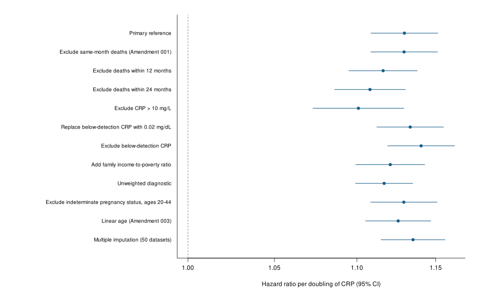
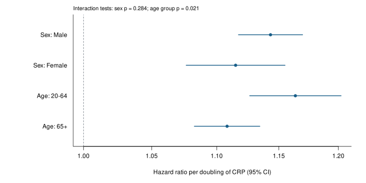

## Supplementary Figure S1

{fig-alt="Primary and sensitivity hazard ratios with 95 percent confidence intervals" width=100%}

**Supplementary Figure S1. Primary and sensitivity analyses.** All estimates use the CRP coefficient per doubling. 
The same-month-death exclusion removes two complete-case deaths. The income analysis changes both sample and adjustment. 
Linear age is a disclosed post-primary specification. The unweighted estimate is diagnostic only. 
Normal intervals are used except for MI, which uses finite Barnard-Rubin t inference. 
Similar estimates do not establish equivalence or absence of shared bias.

## Supplementary Figure S2

{fig-alt="CRP hazard ratios by sex and age group from separate interaction models" width=100%}

**Supplementary Figure S2. Secondary interaction-model contrasts.** Models retain primary adjustment and the continuous-age spline. 
The age-group model additionally includes the 65+ group main effect. Group intervals are normal covariance-based contrasts. 
Design-based interaction tests: sex F(1,66)=1.167, p=0.284; age F(1,65)=5.575, p=0.021. 
Interval overlap is not a formal interaction test; these analyses do not establish causal effect modification.

[Return to the illustrated manuscript](manuscript_methods_results.html).
